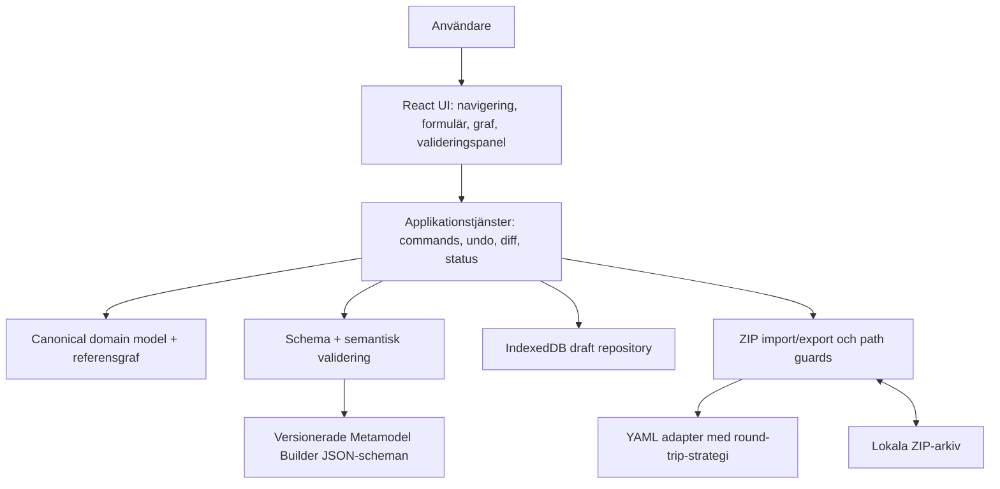

# Målarkitektur – Metamodel Studio 0.1.0

## C4 nivå 1 – Kontext
Modellarkitekt och granskare <-> Metamodel Studio PWA <-> lokala ZIP-filer. Webbläsarens IndexedDB lagrar arbetsutkast. Ingen backend i MVP, ingen extern dataöverföring. Metamodel Builder används som **formatkontrakt**, inte som runtime-beroende.

## C4 nivå 2 – Komponenter

## Moduler och gränser
- `app/`: routing, projektlivscykel och tydlig redigeringsstatus.
- `features/`: element, relationer, properties, constraints, viewpoints, notation, provenance, guidance, version.
- `domain/`: typade modeller, invariants, kommandon, referensupplösning, diff och stale-state.
- `adapters/yaml/`: parser/serialiserare. Bevara okända schema-kompatibla fält och försök bevara ordning/kommentarer; om kommentarstrohet inte kan garanteras, varna före skrivning.
- `adapters/zip/`: lista, import, path normalization, zip-slip/zip-bomb skydd, export; bibehåll originalbytes för ej ändrade filer.
- `validation/`: JSON-schema-värdering + portade semantiska regler med konformitetstester mot originalets Python-validator.
- `storage/`: IndexedDB drafts och exportbara backups.
- `ui/`: tillgängliga formulär, tabeller, navigering, status och eventuellt React Flow.

## Beslut
### ADR-001 Browser-only MVP
Val: statisk PWA (React, TypeScript, Vite, service worker). Motiv: offline, integritet, kostnad. Konsekvens: Python-baserad generering ej direkt tillgänglig.
### ADR-002 Canonical YAML är primär
Val: bevara hela ZIP:en som arkiv med selektiv modifiering av explicit redigerade canonical-filer. Motiv: undvika datatapp, bevara dokumentation och plattformspaket.
### ADR-003 Validatorparitet före giltighetsstämpel
Val: JSON Schema (t.ex. Ajv) och portad semantisk validator verifieras med goldens mot scripts/validate_semantics.py. Till dess visas 'delvis validerad' i stället för 'giltig'.
### ADR-004 Versionerade formatadapters
Val: schema_version -> explicit adapter, inga tysta migreringar. Okända versioner öppnas endast i read-only när rimligt.
### ADR-005 Utdata med proveniens
Val: exportstatus `draft`, `schema-valid`, `semantics-valid`, `release-ready` (sista endast efter relevanta generator-/plattformskontroller). Ändrat canonical + befintlig generated => stale.

## Centralt dataflöde
1. File input -> säker ZIP-unpack i minnet med storleksgränser -> entries + SHA-256.
2. Projektdetektion -> parse åtta canonical YAML -> explicit versionsadapter -> typad modell + diagnostik.
3. Skrivskyddat original + muterbara kommandoändringar -> referensintegritet/valideringsresultat -> lokal draft.
4. Export: uppdatera bara ändrade YAML-filer i original-entry-set; behåll övriga bytes; lägg vid behov till **separat** studiospecifik validerings-/ändringsrapport utan att skriva om originalprojektets statusfiler per automatik.
5. Återimport + semantisk jämförelse + kontrollsummor för opåverkade poster + friskhetsstatus innan ZIP erbjuds.

## Säkerhet
Ingen eval eller körning av importerade skript. Skydda mot traversering (`../`, absoluta sökvägar, Windowsvarianter), symlänkar, extrema kompressionskvoter, entry count, komprimerad/okomprimerad totalstorlek, YAML alias-expansion, HTML/markdown-injektion och localStorage-läckor. Använd CSP, inga fjärrskript. Behåll användarens lokala filer på klienten.

## Driftsättning och observability
Bygg statiska assets och publicera valfritt på statisk HTTPS-host (GitHub Pages eller befintlig PWA Preview). SW-version och cachebyte ska vara säkra för öppna utkast. Ingen serverloggning av användarmodeller; felsökningslogg exporteras lokalt med redakterat innehåll.

## Prestanda och återhämtning
Streaming/worker där nyttigt; explicit importerad maxstorlek och fallback vid minnesbrist. Atomic draft writes per revision, crash recovery, manuell filnedladdning, och test av Safari/iPadOS-kvoter. Filväljare/Download har Safari-begränsningar som hanteras med fallback.

## Riskskala
- Hög: YAML-kommentar-/formateringstrohet, semantisk validatorparitet, stale genererade artefakter, Safari export.
- Medel: modellrefaktorering och cirkulära arv, ZIP säkerhet, storleksprestanda.
- Låg: statisk hosting.
Riskerna hanteras genom DEV-001/002 upptäckande tester innan redigeringsfunktioner aktiveras.
